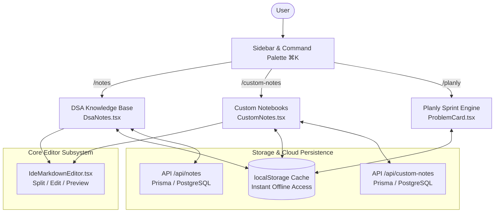
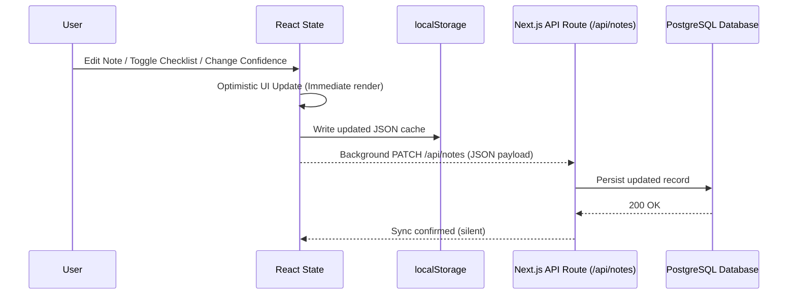

# AlgoCraft Notes Ecosystem: Architectural Analysis & Functional Specification

## 1. Executive Summary

The **Notes Ecosystem** in AlgoCraft provides an integrated, multi-tier knowledge management and spaced repetition framework. Rather than a generic text editor, it combines:

1. **Curated Curriculum Mastery (`/notes`)**: A structured knowledge repository covering 29+ core Data Structures & Algorithms topics, organized into 9 distinct study dimensions with a 6-stage mastery self-evaluation matrix.
2. **Modular Developer Notebooks (`/custom-notes`)**: A flexible, section-driven notebook for system design, project architecture, language cheat sheets, and custom checklists.
3. **In-Sprint Contextual Problem Notes (`/planly`)**: Lightweight, per-problem reflection drawers embedded directly within daily sprint tasks to log edge cases, intuitions, and stopwatch metrics.
4. **Core Markdown Engine (`IdeMarkdownEditor.tsx`)**: A synchronized dual-pane IDE editor supporting custom syntax, syntax-highlighted code fences, inline colored marks, and document outline navigation.

---

## 2. High-Level Architecture Diagram



---

## 3. DSA Knowledge Base (`/notes` / `components/DsaNotes.tsx`)

The DSA Notes system is located at `components/DsaNotes.tsx` and served via `app/notes/page.tsx`.

### 3.1 Data Model (`NoteTopic`)

Each topic represents an exhaustive, self-contained algorithmic knowledge unit:

```typescript
type MasteryState = {
  understandTheory: boolean;  // Core concept grasp
  canExplain: boolean;        // Ability to articulate clearly
  canSolveEasy: boolean;      // Baseline application
  canSolveMedium: boolean;    // Standard interview problem capability
  canSolveHard: boolean;      // Edge-case & optimization mastery
  canTeachSomeone: boolean;   // First-principles mastery
};

type NoteTopic = {
  id: number;
  name: string;               // e.g. "Binary Search", "Graphs - BFS & DFS"
  level: "Beginner" | "Intermediate" | "Advanced" | "Expert";
  notes: string;              // Full comprehensive Markdown text
  revisionNotes: string;      // 15-minute quick pre-interview cheat sheet
  importantPoints: string[];  // Conceptual bullet points
  memoryTricks: string[];     // Mnemonics & pattern triggers
  algorithms: string[];       // Step-by-step logic & pseudocode
  formulas: string[];         // Mathematical recurrences & bounds
  examples: string[];         // Reusable code templates
  patterns: string[];         // Associated pattern archetypes
  keywords: string[];         // Problem statement trigger terms
  timeComplexities: string[]; // Best, Average, Worst case
  spaceComplexities: string[];// Stack, Heap, Auxiliary bounds
  interviewTips: string[];    // Communication & interviewer signals
  commonMistakes: string[];   // Critical pitfalls & off-by-one errors
  tutorQuestions: string[];   // Self-test diagnostic queries
  practiceProblems: string[]; // Curated LeetCode / Sheet links
  resources: string[];        // Video walkthroughs & articles
  doubts: string[];           // Unresolved questions scratchpad
  lastRevised: string;        // ISO timestamp of latest study session
  revisionCount: number;      // Total spaced repetition passes
  confidence: number;         // 0 - 100% subjective confidence rating
  mastery: MasteryState;      // 6-stage objective mastery flags
  favorite: boolean;          // Bookmarked status
  completed: boolean;         // Overall topic completion mark
};
```

### 3.2 Main Dashboard Layout & Spatial Geometry

```
┌────────────────────────────────────────────────────────────────────────────────────────┐
│ WorkspaceHeader (Logo, Global Search ⌘K, Theme Switcher, Quick Links)                 │
├─────────────────┬──────────────────────────────────────────────────────────────────────┤
│                 │ Header: "DSA Knowledge Base" • Total Topics • Solved Count           │
│                 ├──────────────────────────────────────────────────────────────────────┤
│ Sidebar Filter  │ 5-Deck Metric Strip:                                                 │
│ Controls:       │ [Total Topics] [Completed] [Favorites] [Avg Mastery] [Avg Confidence]│
│ • Level Filters ├──────────────────────────────────────────────────────────────────────┤
│   (Beginner →   │ Filter Bar:                                                          │
│    Expert)      │ [Search input...] [All Levels ▾] [Status: All / Completed / Favs ▾]  │
│ • Status Filters├──────────────────────────────────────────────────────────────────────┤
│   (Completed,   │ Responsive 3-to-4 Column Grid of Topic Cards:                        │
│    Pending,     │ ┌───────────────────────┐ ┌───────────────────────┐                  │
│    Favorites)   │ │ Binary Search         │ │ Two Pointers          │                  │
│                 │ │ Level: Intermediate   │ │ Level: Beginner       │                  │
│                 │ │ Mastery Bar: 83%      │ │ Mastery Bar: 100%     │                  │
│                 │ │ 16 fields • 4 rev     │ │ 12 fields • 2 rev     │                  │
│                 │ │ Conf: 90%             │ │ Conf: 95%             │                  │
│                 │ └───────────────────────┘ └───────────────────────┘                  │
└─────────────────┴──────────────────────────────────────────────────────────────────────┘
```

### 3.3 The 9 Specialized Knowledge Panels (`TopicDetailPanel`)

Clicking any card launches a full-screen overlay workspace (`TopicDetailPanel`) featuring an interactive sidebar routing to 9 distinct study dimensions:

| Panel ID | Panel Name | Content & Functional Purpose | Editor / Component Used |
| :--- | :--- | :--- | :--- |
| `notes` | **Comprehensive Notes** | In-depth theory, diagrams, and code snippets | `IdeMarkdownEditor` (Markdown) |
| `revision` | **Quick Revision** | High-yield 15-minute review cheat sheet before interviews | `IdeMarkdownEditor` (Markdown) |
| `theory` | **Theory & Mnemonics** | Important Points list and Memory Tricks / mental models | Interactive editable lists |
| `algorithms` | **Algorithms & Formulas** | Pseudocode steps and index formulas (e.g. `low + (high - low)/2`) | Structured algorithmic block cards |
| `code` | **Code & Patterns** | Reusable boilerplate implementations and problem keywords | Multi-language code cards & tags |
| `complexities` | **Complexity Matrix** | Precise asymptotic runtime and auxiliary space bounds | Side-by-side complexity cards |
| `interview` | **Interview Prep** | Interviewer expectations, communication tips, common pitfalls | Highlighted callouts & alerts |
| `support` | **Practice & Doubts** | Practice problem links, external videos, and open questions | Resource cards with deep links |
| `mastery` | **Mastery Matrix** | 6-stage self-evaluation checklist + confidence slider | Interactive checkboxes + slider |

### 3.4 Mastery Score Calculation

Mastery percentage is computed dynamically based on the 6 objective criteria:

$$\text{Mastery \%} = \text{round}\left(\frac{\sum \text{checked flags}}{6} \times 100\right)$$

This decoupled system ensures mastery reflects both theoretical understanding and independent problem-solving speed.

---

## 4. Modular Developer Notebooks (`/custom-notes` / `components/CustomNotes.tsx`)

Located at `components/CustomNotes.tsx` and served via `app/custom-notes/page.tsx`.

### 4.1 Data Model (`CustomTopic`)

```typescript
type CustomSection = {
  id: string;
  name: string;
  type: "notes" | "list";      // Full Markdown vs. Interactive Checklist
  content: string;             // Markdown text (when type === "notes")
  items?: string[];            // Checklist entries (when type === "list")
};

type CustomTopic = {
  id: string;
  title: string;
  category?: string;           // e.g. "System Design", "Spring Boot", "DevOps"
  tags?: string[];             // Searchable hashtags
  description?: string;
  color?: string;              // Custom accent border & pill color
  sections: CustomSection[];   // Ordered list of modular sections
  isFavorite?: boolean;
  isPinned?: boolean;
  created_at?: string | Date;
  updated_at?: string | Date;
};
```

### 4.2 Key Features
1. **Dual Section Modality**:
   - **Markdown Notes**: Used for long-form documentation, architecture diagrams, and code snippets.
   - **Interactive Checklist**: Used for task checklists, roadmap milestones, and interview question queues with reordering buttons (`MoveUp`, `MoveDown`).
2. **Template Library**:
   - Built-in blueprints for *Blank Notebook*, *Project Architecture*, and *System Design Deep Dive*.
3. **Flexible Section Hierarchy**:
   - Add, rename, reorder, or delete sections inside any notebook without data loss.

---

## 5. In-Sprint Contextual Problem Notes (`Planly` / `ProblemCard.tsx`)

In `components/planly/ProblemCard.tsx`, each daily task includes an embedded lightweight notes drawer:

- **Trigger**: Clickable `Add Notes` or `Notes (1)` toggle button in the stopwatch row.
- **Drawer**: Expandable `textarea` matching the theme surface (`bg-[#141923] border-[#1E293B]`).
- **Workflow**:
  1. Start stopwatch on problem.
  2. Test approach and log mistakes or complexity discoveries directly into the notes drawer on blur.
  3. Select spaced repetition confidence (`Clean (+10d)`, `Needed Hint (+5d)`, `Struggled (+2d)`).
  4. Notes persist with the task in sprint state and sync to local storage and the habit engine.

---

## 6. The Core Markdown Engine (`IdeMarkdownEditor.tsx`)

Both **DSA Notes** and **Custom Notes** share the unified `IdeMarkdownEditor` component:

### 6.1 View Modes
- **Split View**: Left-hand editing pane, right-hand live rendering preview with synchronized scrolling.
- **Edit Only**: Maximized distraction-free code editor with line numbers and monospace typography.
- **Preview Only**: Clean documentation reading mode with styled code blocks, tables, and alerts.

### 6.2 Custom Markdown Syntax & Protected Highlights
The editor features a custom rendering pipeline for colored visual marks that remain high-contrast across all 11 themes:

```markdown
==r:Critical edge case or bug==       -> Renders rose alert highlight
==g:Optimal O(N) solution insight==   -> Renders emerald mint highlight
==b:Standard library method==         -> Renders sky blue highlight
==y:Interviewer follow-up question==  -> Renders amber warning highlight
==p:Mathematical formula pattern==    -> Renders purple syntax highlight
```

---

## 7. Synchronization & Storage Architecture

AlgoCraft uses an **Offline-First Optimistic Sync** design pattern:



- **Resilience**: If the server is offline or returns an error, the local storage cache continues to serve the full knowledge base seamlessly.
- **Cloud Backup**: As soon as connectivity is restored, mutations propagate to the server without blocking the user interface.

---

## 8. Cross-Module Deep Linking

The notes system connects directly with other modules in AlgoCraft:

1. **DSA Sheet Integration**: Problem cards in `/notes` link directly to `/dsaquestions?q=<ProblemName>` to immediately access LeetCode links, company frequency data, and problem discussions.
2. **Global Command Palette (⌘K / Ctrl+K)**: Typing topic names or keywords in the global command palette provides instant navigation to corresponding notes.
3. **Planly Sprints**: Tasks scheduled by the Planly engine display pattern badges that match topic modules in DSA Notes.
