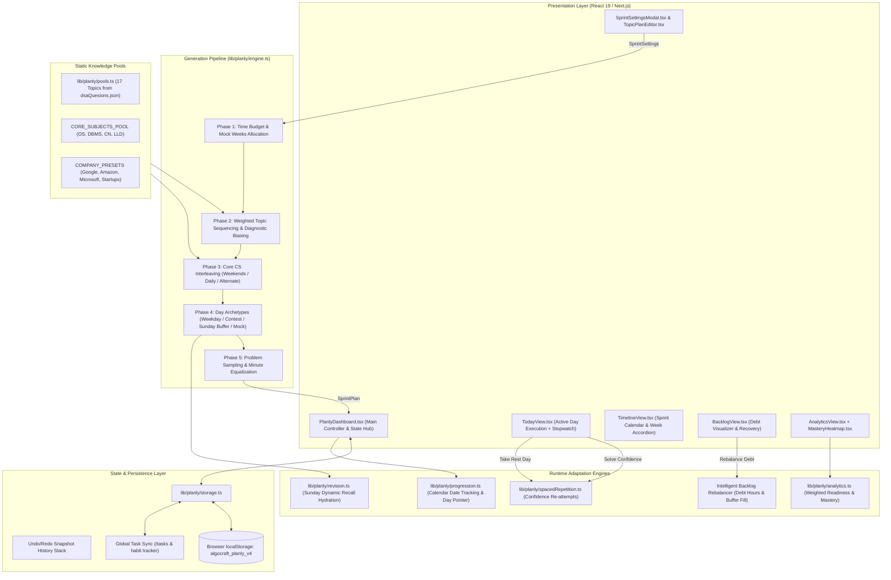
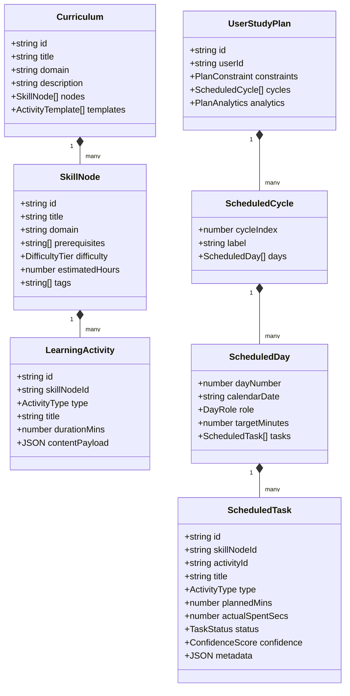
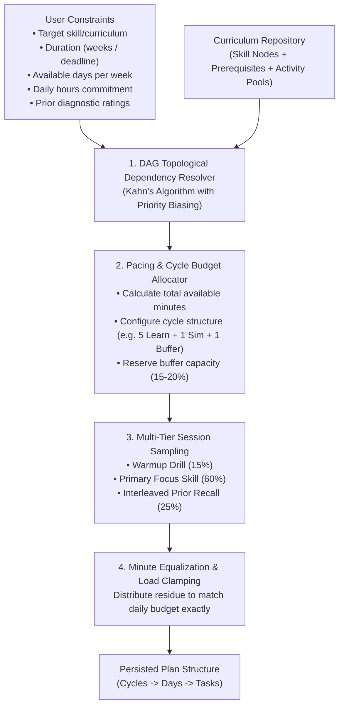

# Planly Architecture & Custom Multi-Skill Planning Engine Blueprint

**Document Version:** 1.0.0  
**Target System:** Planly Engine (`/planly`)  
**Generated Date:** October 16, 2026  
**Document Type:** System Architecture Report & Clean-Slate Engineering Blueprint  

---

## 1. Executive Summary

This report delivers a comprehensive architectural review of AlgoCraft's **Planly** system and outlines a concrete blueprint to build a **generalized, multi-skill custom planner from scratch**.

Current Planly is an algorithmic study-sprint generator designed specifically for technical interview preparation (DSA and Core Computer Science subjects). It translates high-level user parameters (duration in weeks, target company, daily hours, diagnostic strengths/weaknesses) into a structured daily curriculum with time-budgeted activities, Saturday contests, Sunday buffer reviews, and confidence-triggered spaced repetition.

To build a **Custom Planly** capable of planning for **any arbitrary skill domain** (e.g., Web Development, Machine Learning, DevOps, Language Learning, Music, Academic Exams, Fitness), the hardcoded domain assumptions (LeetCode URLs, DSA topics, company presets) must be abstracted into a **pluggable, graph-based curriculum and pacing engine**.

---

## 2. High-Level Architecture of Current Planly



---

## 3. Detailed Component Breakdown of Current Planly

### 3.1 Data Structures & Schemas ([`lib/planly/types.ts`](file:///d:/Development%20Projects/dailytasks/lib/planly/types.ts))

The system organizes a study sprint hierarchically:

```mermaid
erDiagram
    SprintSettings ||--|| SprintPlan : configures
    SprintPlan ||--|{ PlanWeek : contains
    PlanWeek ||--|{ PlanDay : contains
    PlanDay ||--|{ PlanTask : contains

    SprintSettings {
        int weeks
        int dailyHours
        string coreScheduleMode
        string[] selectedCores
        string targetCompany
        string language
        boolean includeMockContests
        json diagnostic
        int sundayRevisionMins
    }

    SprintPlan {
        json metadata
        PlanWeek[] weeks
        SprintSettings settings
    }

    PlanWeek {
        int weekNumber
        string weekFocus
        boolean isMockInterviewWeek
        PlanDay[] days
    }

    PlanDay {
        int dayNumber
        int dayOfWeek
        string calendarDate
        boolean isBufferDay
        boolean isSaturday
        boolean isRestDay
        int allocatedMins
        PlanTask[] tasks
    }

    PlanTask {
        string id
        string track
        string title
        string subject
        int timeMins
        int timeSpentSecs
        string confidence
        boolean completed
        boolean isBacklogEligible
        string problemUrl
        string videoUrl
        string difficulty
        string intuitionHint
        json revisionMeta
    }
```



---

### 3.2 Schedule Generation Engine ([`lib/planly/engine.ts`](file:///d:/Development%20Projects/dailytasks/lib/planly/engine.ts))

The generation logic runs in 5 deterministic phases using a pseudo-random number generator ([`lib/planly/random.ts`](file:///d:/Development%20Projects/dailytasks/lib/planly/random.ts)):

1. **Mock Weeks & Timeline Allocation**:
   - Total days: $\text{weeks} \times 7$.
   - If $\text{weeks} \ge 12 \rightarrow$ 2 Mock Interview Weeks reserved at the end.
   - If $6 \le \text{weeks} < 12 \rightarrow$ 1 Mock Interview Week reserved.
2. **Weighted Topic Sequence**:
   - Iterates through the 17 DSA topics.
   - Modifies weights based on:
     - **Company profiles**: Google prioritizes DP/Graphs; Amazon prioritizes Trees/LLD; Microsoft prioritizes Arrays/Strings.
     - **User diagnostic (1–5 scale)**: Any domain rated $\le 2$ receives $+1$ base weight.
   - Assembles a sequence array cycling through weighted topics.
3. **Core CS Interleaving**:
   - Selects subjects from `CORE_SUBJECTS_POOL` (`os`, `dbms`, `cn`, `lld`).
   - Distributes subjects based on user selection:
     - `weekends`: Core subjects placed only on Saturday and Sunday.
     - `daily`: Parallel DSA and Core CS every weekday (65% DSA / 35% Core CS).
     - `alternate`: Core CS scheduled on alternating days (Days 2, 4, 6).
4. **Day Archetypes**:
   - **Weekdays (Mon–Fri)**: $65\%$ DSA problems, $35\%$ Core CS drill.
   - **Saturday (Timed Contest)**: 90-minute timed contest simulation ($Q_1$ Easy 20m, $Q_2$ Medium 35m, $Q_3$ Hard 35m) + leftover minutes for contest editorial review.
   - **Sunday (Buffer & Revision)**: Shock absorber for schedule drift: $55\%$ backlog clearance + $45\%$ conceptual synthesis.
   - **Mock Weeks**: Timed mock interviews, High-Level Architecture simulations, and STAR retrospectives.
5. **Multi-Problem Sampling (`sampleProblemsForDay`)**:
   - Divides DSA daily time budget into discrete cards:
     - 1 Warmup (Easy, 30m).
     - 1 Advanced Challenge (Hard, 60m if high budget or Google).
     - Core Patterns (Medium, 40–45m each).
   - **Exact Minute Equalization**: Leftover residue ($< 25$ mins) is distributed evenly across all chosen tasks so that $\sum \text{allocatedMins} \equiv \text{targetMins}$ down to the minute.

---

### 3.3 Dynamic Revision System ([`lib/planly/revision.ts`](file:///d:/Development%20Projects/dailytasks/lib/planly/revision.ts))

To keep schedules dynamic and prevent stale plans:
* Sunday slots are created as lightweight revision metadata blocks (`retro`, `backlog`, `prior-pool`).
* When Sunday is reached, `hydrateSundayRevision()` dynamically populates concrete questions based on topic status (`studied`) and user confidence (`rusty` = weight 3, `okay` = weight 2, `solid` = weight 1), applying company-critical multipliers.

---

### 3.4 Runtime Adaptation & Feedback Loops

1. **Spaced Repetition Engine ([`lib/planly/spacedRepetition.ts`](file:///d:/Development%20Projects/dailytasks/lib/planly/spacedRepetition.ts))**:
   Triggered when a user completes a problem in `ProblemCard.tsx` and selects a confidence rating:
   - `struggled` $\rightarrow$ Injects a re-attempt drill task on **$Day + 2$**.
   - `hint` $\rightarrow$ Injects a re-attempt drill task on **$Day + 5$**.
   - `clean` $\rightarrow$ Injects a re-attempt drill task on **$Day + 10$**.
2. **Rest Day Recovery**:
   Allows taking an unscheduled break without breaking streaks. Clears current day tasks, injects a 0-minute completed Rest Card, and rolls uncompleted tasks forward into upcoming weekend buffer days.
3. **Debt Rebalancer**:
   Calculates accumulated debt: $\text{debtHours} = \sum(\text{past incomplete minutes}) / 60$. If debt exceeds 3.0 hours, users can trigger 1-click rebalancing to redistribute backlog items into upcoming light buffer days.
4. **Calendar Synchronization ([`lib/planly/progression.ts`](file:///d:/Development%20Projects/dailytasks/lib/planly/progression.ts))**:
   Tracks real-world local dates (`YYYY-MM-DD`) and automatically updates the active day pointer when the user logs in on a new calendar day.

---

### 3.5 Analytics & Readiness Scoring ([`lib/planly/analytics.ts`](file:///d:/Development%20Projects/dailytasks/lib/planly/analytics.ts))

- **Effective Completion Score**:
  $$\text{EffectiveDone} = (1.0 \times \text{clean}) + (0.6 \times \text{hints}) + (0.3 \times \text{struggled})$$
- **Target Company Readiness Score**:
  Blends company-weighted domain readiness ($75\%$) with global completion ($25\%$):
  $$\text{ReadinessScore} = \min(100, \text{round}(0.75 \times \text{dsaReadiness} + 0.25 \times \text{globalCompletion}))$$

---

### 3.6 Storage & Persistence Layer ([`lib/planly/storage.ts`](file:///d:/Development%20Projects/dailytasks/lib/planly/storage.ts))

- Persists to browser `localStorage` under `algocraft_planly_v4`.
- Automated schema migrations from older versions (v2, v3).
- In-memory undo snapshot stack (`pushUndoSnapshot`, `popUndoSnapshot`).
- Two-way synchronization with global tasks via `syncDayToHabitTasks` and `reconcileWithCompletedHabits`.

---

## 4. Current Limitations & Hardcoded Assumptions

| Area | Current Implementation | Why It Fails For Arbitrary Skills |
| :--- | :--- | :--- |
| **Domain Schema** | Tightly coupled to LeetCode fields (`leetcodeUrl`, `difficulty`, `timeComplexity`, `spaceComplexity`) | Irrelevant for learning an instrument, language, DevOps, fitness, or design. |
| **Curriculum Structure** | Flat 17 DSA topics and 4 fixed Core CS subjects | Cannot define arbitrary courses, modules, sub-skills, or chapters. |
| **Prerequisites** | Metadata exists in JSON but is ignored during scheduling; uses modulo cycling | High-priority topics can be scheduled before their foundational prerequisites (e.g. DP before Recursion). |
| **Day Structure** | Fixed Mon–Fri (DSA+Core), Saturday Contest, Sunday Buffer | Non-coding skills need different activity types (e.g., Vocab drills, Listening sessions, Project labs, Theory reading). |
| **Spaced Repetition** | Hardcoded offsets (+2, +5, +10 days) with no slot clamping | Blindly appends tasks to future days without verifying if that day already exceeds the daily hour budget. |
| **Persistence** | Single-user client-side `localStorage` | Cannot sync across devices, support collaborative learning, or share curricula. |

---

## 5. Architectural Blueprint: Custom Multi-Skill Planly

To build a custom planner that can handle **any skill or curriculum**, follow this clean-slate architectural design.

### 5.1 Domain-Agnostic Core Data Model



#### TypeScript Schema Specifications:

```typescript
export type ActivityType = 
  | "theory_reading"       // Conceptual absorption / docs / video
  | "hands_on_practice"    // Coding, exercises, drills, problem sets
  | "spaced_recall"        // Flashcards, active recall questions
  | "project_lab"          // Building an artifact / capstone
  | "timed_simulation"     // Contests, mock exams, speaking practice
  | "synthesis_review";    // Reflection, notes consolidation

export type DayRole = "learning" | "project_lab" | "simulation" | "buffer_recovery" | "rest";

export interface SkillNode {
  id: string;
  title: string;
  domain: string;
  prerequisites: string[]; // IDs of SkillNodes that MUST be cleared first
  difficultyTier: "beginner" | "intermediate" | "advanced";
  estimatedMinutes: number;
  tags: string[];
}

export interface LearningActivity {
  id: string;
  skillNodeId: string;
  type: ActivityType;
  title: string;
  durationMins: number;
  content: {
    instructionsMarkdown?: string;
    resourceUrls?: { label: string; url: string }[];
    externalId?: string;
    hints?: string[];
    customProps?: Record<string, unknown>;
  };
}
```

---

### 5.2 Generalized Scheduling & Generation Pipeline



#### 1. Topological Dependency Resolver (Kahn's Algorithm)
Prevents dependency inversion by guaranteeing that a skill node is never scheduled until all nodes in its `prerequisites` array have been scheduled and cleared:
```typescript
function resolveTopologicalSequence(
  nodes: SkillNode[],
  userPriorRatings: Record<string, number> // 1 to 5
): SkillNode[] {
  const inDegree = new Map<string, number>();
  const graph = new Map<string, string[]>();

  nodes.forEach((n) => {
    inDegree.set(n.id, n.prerequisites.length);
    n.prerequisites.forEach((pre) => {
      if (!graph.has(pre)) graph.set(pre, []);
      graph.get(pre)!.push(n.id);
    });
  });

  // Priority queue biased by user weakness: lower rating = higher priority once unlocked
  const availableQueue: SkillNode[] = nodes.filter((n) => inDegree.get(n.id) === 0);
  const ordered: SkillNode[] = [];

  while (availableQueue.length > 0) {
    availableQueue.sort((a, b) => {
      const ratingA = userPriorRatings[a.id] ?? 3;
      const ratingB = userPriorRatings[b.id] ?? 3;
      return ratingA - ratingB; // weaker skills first
    });

    const current = availableQueue.shift()!;
    ordered.push(current);

    const neighbors = graph.get(current.id) || [];
    for (const neighborId of neighbors) {
      inDegree.set(neighborId, inDegree.get(neighborId)! - 1);
      if (inDegree.get(neighborId) === 0) {
        const nextNode = nodes.find((n) => n.id === neighborId)!;
        availableQueue.push(nextNode);
      }
    }
  }

  return ordered;
}
```

#### 2. Interleaved Spiral Practice Structure
Instead of spending an entire week on one topic exclusively (blocked practice), the generator uses an **interleaving ratio**:
- **$60\%$ Primary Focus**: New concept progression along the DAG.
- **$25\%$ Spaced Active Recall**: Retrieval drills for previously studied nodes.
- **$15\%$ Warmup & Synthesis**: Quick quizzes or hands-on application.

#### 3. Modern Spaced Repetition (FSRS / SM-2)
Replace static $+2, +5, +10$ jumps with the **SuperMemo SM-2** algorithm or **FSRS**:
- After each activity, user rates performance $q \in [1..5]$ (*Again*, *Hard*, *Good*, *Easy*).
- Calculate updated Easiness Factor ($EF$) and interval ($I$):
  $$EF' = \max\left(1.3, \; EF + (0.1 - (5 - q) \times (0.08 + (5 - q) \times 0.02))\right)$$
  $$I(1) = 1, \quad I(2) = 6, \quad I(n) = \text{round}(I(n-1) \times EF')$$
- **Capacity Clamping**: When injecting a review task at Day $D + I$, check that day's allocated minutes. If that day is already full, roll forward to the nearest available buffer day.

#### 4. Resilient Backlog Buffer Absorption
- Designate recurring buffer slots (e.g., every 7th day, or flexible weekend windows).
- Compute debt load in real time.
- If tasks are missed, distribute uncompleted tasks into low-density buffer days without breaking user streaks or causing schedule collapse.

---

## 6. Recommended Technology Stack for Custom Planly

| Architectural Tier | Recommended Technology | Technical Justification |
| :--- | :--- | :--- |
| **Fullstack Framework** | **Next.js (App Router) + TypeScript** | Server Components for instant rendering; Server Actions for atomic updates. |
| **Database & ORM** | **PostgreSQL + Prisma ORM** | Relational structures naturally represent DAG node prerequisites and user completion histories. |
| **State & Local-First Cache** | **Zustand + TanStack Query** (or **RxDB/Dexie.js**) | Provides offline-first capability so the stopwatch and checklist work seamlessly offline. |
| **Styling & UI Library** | **Vanilla CSS Modules / Tailwind + Lucide Icons** | High-performance, low bundle weight, clean light/dark mode support. |
| **Drag & Drop** | **@hello-pangea/dnd** or **dnd-kit** | Smooth reordering of curriculum nodes and backlog tasks across calendar days. |
| **Export Formats** | **`ical-generator` + Markdown parser** | One-click export to Google Calendar (`.ics`), Notion, or printable study sheets. |

---

## 7. Step-by-Step Implementation Roadmap

```mermaid
gantt
    title Custom Planly Development Roadmap
    dateFormat  X
    axisFormat Day %d

    section Phase 1: Core Models & Engine
    Define Universal Schemas (Curriculum, SkillNode, Activity) :p1_1, 0, 3
    Build DAG Topological Scheduler (Kahn's Algorithm)          :p1_2, 3, 6
    Implement Multi-Tier Pacing & Time Equalization            :p1_3, 6, 9

    section Phase 2: Runtime Loops & Adaptation
    SM-2 / FSRS Spaced Repetition Engine                       :p2_1, 9, 12
    Buffer Shock Absorbers & Intelligent Rebalancer            :p2_2, 12, 15
    Progress Tracker, Timer & Calendar Synchronization         :p2_3, 15, 18

    section Phase 3: UI & Curriculum Builder
    TodayView with Stopwatch & Confidence Triggers             :p3_1, 18, 22
    TimelineView & Backlog View                                :p3_2, 22, 26
    Visual Curriculum / Skill Tree Editor                      :p3_3, 26, 30

    section Phase 4: Persistence & Cloud Sync
    Prisma Database Schema & Server Actions                    :p4_1, 30, 33
    Calendar Export (.ics) & Markdown Download                 :p4_2, 33, 35
```



---

## 8. Summary & Next Steps

Current Planly provides a solid blueprint for:
1. Dynamic time-budgeted task sampling.
2. Shock-absorber buffer days (Sunday backlogs).
3. Runtime feedback via confidence triggers and debt rebalancing.

To build your **custom, multi-skill Planly from scratch**:
* Replace the hardcoded LeetCode/DSA schemas with generic `SkillNode` and `LearningActivity` models.
* Replace the linear modulo sequence with a **DAG topological dependency scheduler**.
* Use standard memory retention models (SM-2/FSRS) for review scheduling.
* Decouple the UI so any curriculum (coding, languages, academic exams, music) can be loaded dynamically via JSON or a visual curriculum builder.
