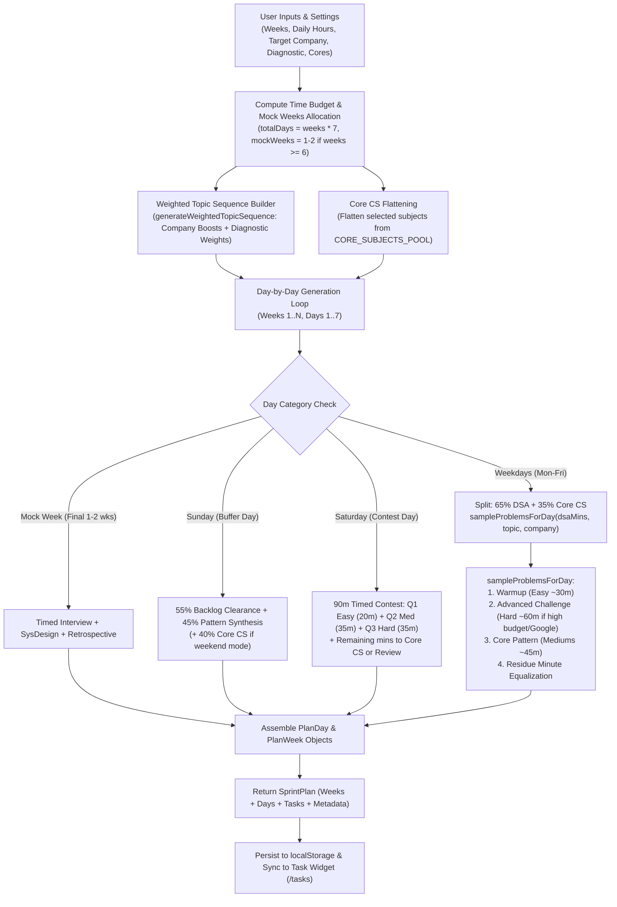

# Planly Engine: In-Depth Plan Generation Architecture & Improvement Blueprint

**Document Version:** 1.0.0  
**Target System:** Planly AI Sprint Planner (`/planly`)  
**Core Codebase Files:**  
- Engine: [`lib/planly/engine.ts`](file:///d:/Development%20Projects/dailytasks/lib/planly/engine.ts)  
- Types & Interfaces: [`lib/planly/types.ts`](file:///d:/Development%20Projects/dailytasks/lib/planly/types.ts)  
- Question & Subject Pools: [`lib/planly/pools.ts`](file:///d:/Development%20Projects/dailytasks/lib/planly/pools.ts)  
- Spaced Repetition & Rebalancing: [`lib/planly/spacedRepetition.ts`](file:///d:/Development%20Projects/dailytasks/lib/planly/spacedRepetition.ts)  
- Analytics & Scoring Engine: [`lib/planly/analytics.ts`](file:///d:/Development%20Projects/dailytasks/lib/planly/analytics.ts)  
- Storage & Reconciler: [`lib/planly/storage.ts`](file:///d:/Development%20Projects/dailytasks/lib/planly/storage.ts)  
- Question Bank Dataset: [`lib/data/dsaQuesions.json`](file:///d:/Development%20Projects/dailytasks/lib/data/dsaQuesions.json)  

---

## Executive Summary

**Planly** is AlgoCraft's specialized, schedule-aware interview preparation engine. It dynamically converts high-level user parameters (duration in weeks, target company, daily commitment hours, baseline diagnostic ratings, and Core CS subject preferences) into an end-to-end, day-by-day technical study roadmap.

Unlike generic static question sheets (such as static PDFs or raw Notion tables), Planly incorporates:
1. **Dynamic Time-Budgeted Problem Sampling** based on daily hours.
2. **Company-Specific Domain Weighting** (e.g., Google DP/Graphs priority vs. Amazon LLD/Trees priority).
3. **Structured Day Specialization** (Weekday drills, Saturday 3-question timed contest simulations, Sunday buffer/backlog clearance).
4. **Adaptive Runtime Feedback Loops** (Spaced Repetition offsets triggered by solve confidence, rest-day task shifting, and intelligent backlog debt rebalancing).

This report outlines the **exact mathematical and algorithmic pipeline** used to generate plans, evaluates current structural limitations, and delivers a concrete **engineering roadmap** to upgrade Planly into an enterprise-grade, adaptive pedagogical AI planner.

---

## 1. End-to-End Generation Pipeline

The schedule generation starts when the user finishes the onboarding wizard or updates their sprint settings in `SprintSettingsModal.tsx`. The core entry point is `generateSchedule(settings: SprintSettings)` in [`lib/planly/engine.ts`](file:///d:/Development%20Projects/dailytasks/lib/planly/engine.ts#L200).



---

## 2. Algorithmic Breakdown of Plan Generation

### Phase 2.1: Mock Weeks & Timeline Partitioning
The sprint duration is divided into **Content Weeks** (learning and foundational practice) and **Mock Interview Weeks** (pressure testing and simulations):

$$\text{mockWeeksCount} = \begin{cases} 
2 & \text{if } \text{totalWeeks} \ge 12 \text{ and } \text{reserveMockWeeks} \ne \text{false} \\ 
1 & \text{if } 6 \le \text{totalWeeks} < 12 \text{ and } \text{reserveMockWeeks} \ne \text{false} \\ 
0 & \text{otherwise} 
\end{cases}$$

$$\text{contentWeeksCount} = \max(1, \text{totalWeeks} - \text{mockWeeksCount})$$

The final $\text{mockWeeksCount}$ weeks of the sprint are marked with `isMockInterviewWeek = true`.

---

### Phase 2.2: Topic Sequencing & Diagnostic Weighting
Planly selects DSA modules from `DSA_TOPICS_POOL` (which parses 17 categories from [`lib/data/dsaQuesions.json`](file:///d:/Development%20Projects/dailytasks/lib/data/dsaQuesions.json)).

Each topic starts with a base weight of $W_{\text{base}} = 1$. The engine applies multiplicative/additive weight modifications:

```typescript
let weight = 1;

// 1. Company-Specific Bias
if (company.treesGraphsBoost && (item.tag === "trees" || item.tag === "graphs")) weight += 1;
if (company.dpBoost && item.tag === "dp") weight += 1;

// 2. User Diagnostic Weakness Bias (1 to 5 scale)
if (diag) {
  if (item.tag === "dp" && diag.dp <= 2) weight += 1;
  if (item.tag === "graphs" && diag.graphs <= 2) weight += 1;
  if (item.tag === "trees" && diag.trees <= 2) weight += 1;
  if (item.tag === "arrays" && diag.arrays <= 2) weight += 1;
}
```

The sequence is built by projecting topic indices into an array repeated $W_i$ times:
$$\text{topicIndex}(w) = \text{weightedIndices}[(w - 1) \pmod{|\text{weightedIndices}|}]$$

#### Company Presets Profile Matrix:
| Company Preset | DSA Weight | Trees & Graphs Boost | DP Boost | LLD Boost | Focus Characteristic |
| :--- | :---: | :---: | :---: | :---: | :--- |
| **General SDE** | 1.0x | No | No | No | Balanced Striver A2Z coverage |
| **Amazon** | 1.2x | Yes (+1) | No | Yes (+1) | Heavy Trees/Graphs + Low-Level Design |
| **Microsoft** | 1.1x | Yes (+1) | No | No | Strings, Arrays, Trees, OS Primitives |
| **Google** | 1.4x | Yes (+1) | Yes (+1) | No | Multi-dim DP, Complex Graphs, Edge-case Math |
| **High-Growth Startups** | 0.9x | No | No | Yes (+1) | Rapid Problem Solving, Machine Coding, LLD |

---

### Phase 2.3: Core CS Subject Interleaving
Core CS topics are imported from `CORE_SUBJECTS_POOL` for selected domains (`os`, `dbms`, `cn`, `lld`). The scheduling mode dictates when Core CS is scheduled:

1. **`weekends` mode:** Core CS is placed only on Saturday and Sunday.
2. **`daily` mode:** Core CS runs parallel every weekday (Mon–Sat), leaving Sunday as a pure buffer.
3. **`alternate` mode:** Core CS runs on even days (Day 2, 4, 6).

Core topics are stored in a flattened queue and rotated circularly using `coreTopicIndex++`.

---

### Phase 2.4: Day Archetypes & Structure

For each day in a week ($d \in [1..7]$), Planly formats the schedule into one of four archetypes:

#### Archetype 1: Mock Interview Day (Final 1–2 Weeks)
- **Mon–Sat:**
  - **45m Timed Coding Interview** ($\min(60, \text{round}(T \times 0.45))$ mins): LeetCode Hard simulation under strict timed constraints.
  - **High-Level Architecture & Concurrency Simulation** ($\min(60, \text{round}(T \times 0.35))$ mins): System Design drill.
  - **Mock Retrospective & Post-Mortem** ($\max(30, \text{remaining})$ mins): Runtime trade-offs and behavioral STAR analysis.
- **Sunday:**
  - Full-day **Mock Interview Post-Mortem & Deep Notes Consolidation** (100% of daily time).

#### Archetype 2: Sunday Buffer & Consolidation Day
Sunday acts as the shock-absorber for schedule drift:
- **Weekly Backlog Clearance & Spaced Review** ($55\%$ of buffer time): Clears uncompleted tasks flagged from previous days.
- **Deep Dive into Missed Concepts & Flashcards** ($45\%$ of buffer time): Conceptual synthesis.
- *(If weekend core mode is active, Core CS consumes 40% of Sunday, leaving 60% for buffer clearing).*

#### Archetype 3: Saturday Timed Contest Day
Simulates real LeetCode weekly contests:
- **Contest Q1 (Easy Warmup):** 20 minutes. Target: bug-free 1st submission.
- **Contest Q2 (Medium Core Algorithm):** 35 minutes. Target: optimal data structure & invariants.
- **Contest Q3 (Hard Optimization):** 35 minutes. Target: state compression / graph tricks.
- **Remaining Minutes ($\max(0, T - 90)$):** Allocated to Core CS module or Contest Editorial Review.

#### Archetype 4: Regular Weekday (Dynamic Multi-Problem Sampling)
On Monday through Friday:
- If Core CS is enabled: $\text{coreMins} = \text{round}(T \times 0.35)$, $\text{dsaMins} = T - \text{coreMins}$.
- If $\text{coreMins} \ge 60$: Split into two focused tasks: *Concepts* (45%) and *Deep Implementation Drill* (55%).
- $\text{dsaMins}$ is supplied to `sampleProblemsForDay()`.

---

### Phase 2.5: The `sampleProblemsForDay` Algorithm
This function in [`lib/planly/engine.ts`](file:///d:/Development%20Projects/dailytasks/lib/planly/engine.ts#L42-L154) divides the day's DSA time budget into discrete, pedagogically sequenced problem cards:

1. **Deduplication Filter:**
   Maintains a `usedTitles` Set per topic to prevent repeated problems in the same sprint. If available unvisited problems fall below 3, `usedTitles` clears itself to allow fresh revisits.
2. **Difficulty Bucketing:**
   Partitions available questions into `easies`, `mediums`, and `hards`, randomized via Fisher-Yates shuffle.
3. **Tiered Slot Allocation:**
   - **Slot 1 (Warmup):** If $\text{budget} \ge 30$ mins and company is not Google, pops 1 Easy problem for **30 mins**.
   - **Slot 2 (Advanced Challenge):** If $\text{budget} \ge 55$ mins and (Target is Google, or Amazon with $\ge 160$ mins, or general budget $\ge 220$ mins), pops 1 Hard problem for **60 mins**.
   - **Slot 3 (Core Patterns):** Pops Medium problems (**40–45 mins each**) in a `while (budgetLeft >= 40 && mediums.length > 0)` loop.
   - **Slot 4 (Residue Fillers):** If 55+ mins remain, pops another Hard; if 25–35 mins remain, pops a Speed Drill Easy; if 35+ mins remain, pops any remaining question.
4. **Exact Minute Equalization:**
   Any leftover minutes ($< 25$ mins) are divided evenly across all sampled problems:
   $$\Delta m = \lfloor \text{budgetLeft} / N \rfloor, \quad r = \text{budgetLeft} \pmod N$$
   This guarantees that $\sum \text{allocatedMins} \equiv \text{targetMins}$ down to the exact minute.

---

## 3. Dynamic Runtime Feedback Loops

Once generated, the plan is not static. Three active runtime subsystems adapt the roadmap based on user performance:

### 3.1 Spaced Repetition Engine ([`lib/planly/spacedRepetition.ts`](file:///d:/Development%20Projects/dailytasks/lib/planly/spacedRepetition.ts#L10))
When a user completes a problem in `ProblemCard.tsx`, they select a confidence level:
- **`struggled`:** Engine calculates $\text{targetDay} = \text{currentDay} + 2$.
- **`hint`:** Engine calculates $\text{targetDay} = \text{currentDay} + 5$.
- **`clean`:** Engine calculates $\text{targetDay} = \text{currentDay} + 10$.

The engine dynamically creates a new `[Re-attempt Drill]` task and injects it into that future day's task list.

### 3.2 Rest Day Recovery ([`lib/planly/spacedRepetition.ts`](file:///d:/Development%20Projects/dailytasks/lib/planly/spacedRepetition.ts#L71))
When the user clicks "Take a Rest Day":
- The current day's unfinished tasks are swept.
- A rest card is inserted (0 mins, marked completed) preserving the user's streak.
- Unfinished tasks are pushed forward into upcoming Saturday and Sunday buffer days, avoiding guilt and schedule collapse.

### 3.3 Intelligent Rebalancer ([`lib/planly/spacedRepetition.ts`](file:///d:/Development%20Projects/dailytasks/lib/planly/spacedRepetition.ts#L137))
When tasks from past days remain uncompleted, they accumulate as **Debt Hours**:
$$\text{debtHours} = \frac{\sum_{t \in \text{past incomplete}} t.\text{timeMins}}{60}$$

If debt exceeds 3.0 hours, the UI flags an alert. When triggered, the rebalancer spreads backlog tasks into future buffer days that currently hold $\le 4$ tasks, capping total load at 5 tasks per buffer day.

### 3.4 Topic Mastery & Readiness Scoring ([`lib/planly/analytics.ts`](file:///d:/Development%20Projects/dailytasks/lib/planly/analytics.ts#L109))
- **Effective Topic Completion:**
  $$\text{effectiveDone} = (1.0 \times \text{clean}) + (0.6 \times \text{hints}) + (0.3 \times \text{struggled})$$
- **Target Company Readiness Score:**
  Calculates a weighted average where company-critical topics are amplified (e.g., DP & Graphs have weight 3 for Google, Trees & Graphs have weight 2.5 for Amazon). It blends domain readiness ($75\%$) with overall completion percentage ($25\%$):
  $$\text{ReadinessScore} = \min(100, \text{round}(0.75 \times \text{dsaReadiness} + 0.25 \times \text{globalCompletion}))$$

---

## 4. Current Limitations & Architectural Bottlenecks

While the existing system functions well, several design bottlenecks limit its intelligence:

| Area | Current Implementation | Limitation / Failure Mode |
| :--- | :--- | :--- |
| **Topic Sequencing** | Linear modulo `weightedIndices[w % N]` | **Topic starvation & fragmentation:** Once a topic week finishes, it isn't interleaved with future topics. No true spiral curriculum. |
| **Prerequisites** | Metadata present in JSON but ignored in scheduler | **Dependency violations:** May schedule Dynamic Programming before Recursion or Graphs before Trees if weights skew ordering. |
| **Time Estimation** | Static heuristics (30m Easy, 45m Med, 60m Hard) | **Ignores user velocity:** The stopwatch logs real completion time (`timeSpentSecs`), but the planner never updates future time allocations based on actual velocity. |
| **Spaced Repetition** | Fixed static day offsets (+2, +5, +10) | **Schedule overload:** Blindly appends tasks to day $D + k$ without checking if that day already exceeds the daily hour budget. |
| **Contest Questions** | Generic static placeholders | **Non-dynamic contest sets:** Does not pick real past LeetCode contest triples from the database. |
| **Calendar Sync** | Simple day counter without calendar integration | **No external calendar awareness:** Does not integrate with Google Calendar, ICS files, or exam dates. |

---

## 5. Strategic Recommendations & Improvement Blueprint

Here is the phased blueprint to transform Planly into an enterprise-grade AI study engine:

### 🚀 Phase 1: Topological Dependency Graph (Immediate)
- **Implement a DAG (Directed Acyclic Graph) Scheduler:**
  Use the `prerequisites` array already stored in `dsaQuesions.json` (e.g. `Recursion -> Trees -> BST -> DP`).
- Run Kahn's Topological Sort with weighted priority queues so high-priority topics are scheduled as early as their prerequisites are cleared, guaranteeing logical learning progression.

### ⏱️ Phase 2: Velocity-Adaptive Time Budgeting
- **Compute Real User Velocity ($V_{\text{user}}$):**
  Track moving average of `timeSpentSecs / allocatedMins`.
- If a user completes Mediums in 22 minutes (velocity 2.0x), adjust upcoming Medium slots to 25–30 minutes, allowing 4 problems/day instead of 2.
- If a user takes 70 minutes on Mediums, scale down daily volume to prevent burnout.

### 🧠 Phase 3: SM-2 / FSRS Memory Retention Curve
- Replace the static (+2, +5, +10) offsets with an implementation of the **SuperMemo SM-2** or **FSRS (Free Spaced Repetition Scheduler)** algorithm.
- Factor in repetition count ($n$), easiness factor ($EF$), and interval ($I$):
  $$EF' = EF + (0.1 - (5 - q) \times (0.08 + (5 - q) \times 0.02))$$
- **Load-Clamped Injection:** Before adding a review task to Day $X$, check that day's total scheduled minutes. If full, roll forward to the next available buffer slot.

### 🔄 Phase 4: Interleaved "Spiral Curriculum"
- Rather than studying one topic exclusively for an entire week (blocked practice), adopt **interleaved practice**:
  - 60% Current Focus Topic (e.g., Dynamic Programming)
  - 25% Spaced Review of Previous Topics (e.g., Binary Trees, Slidin Window)
  - 15% Core CS or Speed Drills
- Interleaving boosts long-term problem-type discrimination in real interview scenarios.

### 📅 Phase 5: Calendar Export & Sync (ICS / Google Calendar / Notion)
- Provide one-click export to standard `.ics` format.
- Add an interactive download button for printable markdown/PDF roadmaps alongside the current JSON export.

---

## 6. How to Download and Use This Report

You can access and download this report through multiple options:

1. **Local Repository Markdown File:**
   - Saved at: [`docs/planly_plan_generation_report.md`](file:///d:/Development%20Projects/dailytasks/docs/planly_plan_generation_report.md)
   - You can open, copy, or convert this directly to PDF via VS Code / Antigravity Markdown Preview (`Ctrl+Shift+V` $\rightarrow$ Print to PDF).
2. **Direct Browser Download via Next.js Server:**
   - Saved at: [`public/planly_plan_generation_report.md`](file:///d:/Development%20Projects/dailytasks/public/planly_plan_generation_report.md)
   - When running `npm run dev`, open: `http://localhost:3000/planly_plan_generation_report.md` to view or save directly with `Ctrl + S`.
3. **Dedicated Interactive Artifact:**
   - Check the companion Artifact window in your Antigravity panel for a formatted, readable view.
